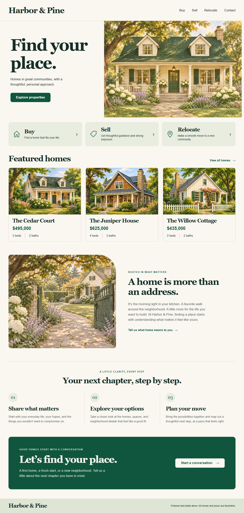
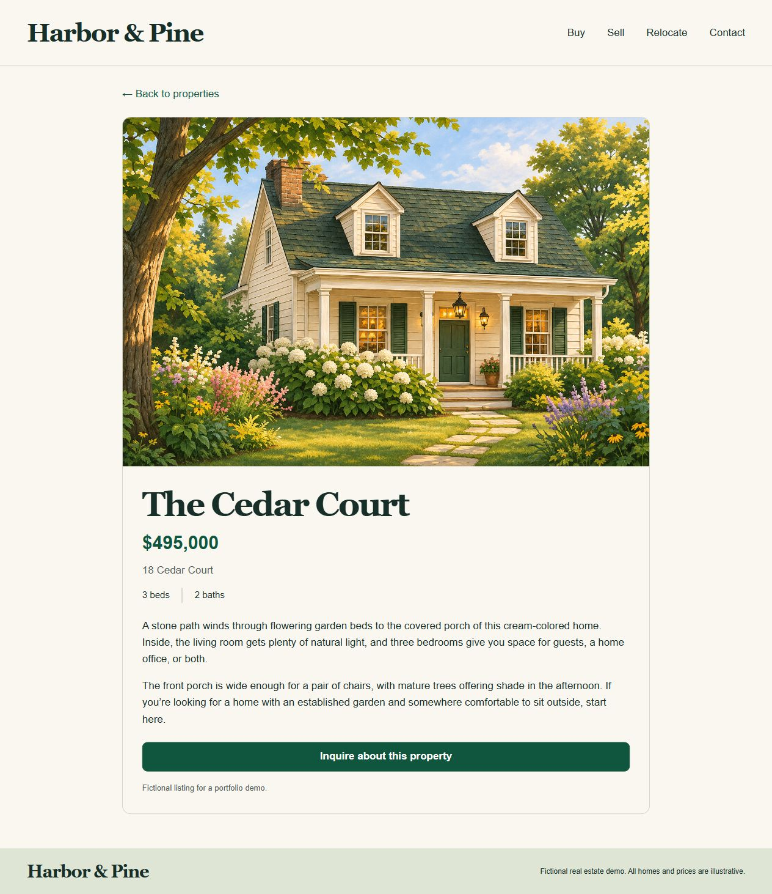
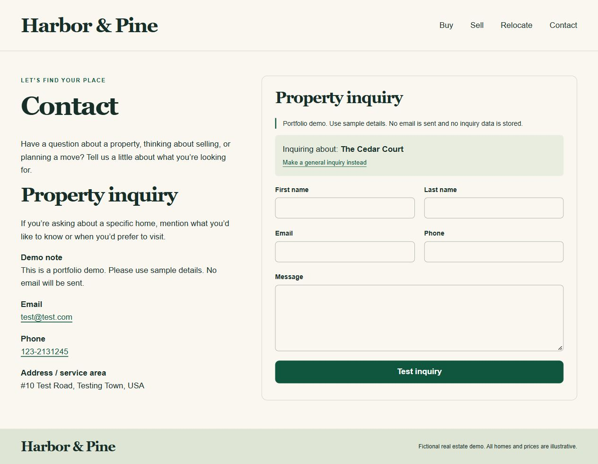

# Harbor & Pine

A fictional real-estate portfolio website built as a classic WordPress theme, with a public static snapshot for Vercel. Built with PHP, plain CSS, and vanilla JavaScript.

**Live demo:** https://harbor-pine-demo-one.vercel.app/

**Source:** https://github.com/KushaCodes1901/harbor-pine-demo

## Screenshots

Captured from the live demo at a 1280px browser viewport.

### Homepage



<details>
<summary>Property details — The Cedar Court</summary>



</details>

<details>
<summary>Contact — property inquiry</summary>



</details>

## Public demo

The `public/` folder contains Home, Buy, Sell, Relocate, Contact, three property detail pages, a 404 page, and local images/styles/scripts. All listings, addresses, prices, and business details are fictional demo content. House and garden illustrations are AI-generated.

The public inquiry form is a browser-only demonstration: it validates sample fields, shows the selected published listing, and displays a test confirmation. No email is sent, no inquiry data is stored, and no form submission request is made. This is separate from the original WordPress Contact Form 7 implementation.

## WordPress source

`wordpress-theme/` contains the classic theme source. Properties use native title/editor/featured images with a secured metadata box. The theme includes admin settings, Media Library pickers, page selectors, and an editable Primary Menu. WordPress, its database/configuration, and plugin files are deliberately excluded.

## Updating the static snapshot

1. Edit pages, properties, and theme options in the local WordPress dashboard.
2. With XAMPP running, rebuild from this folder:

```
C:/xampp/php83/php.exe scripts/export.php C:/xampp/htdocs/harbor-pine
C:/xampp/php83/php.exe scripts/check-export.php
node scripts/check-demo.mjs
```

3. Commit and push the updated public files to GitHub. The Vercel project serves `public/` with no build command or production runtime dependencies.

The exporter copies only public rendered pages and referenced static assets, rewrites local URLs, and replaces exported CF7 markup with the browser-only demo. It does not modify WordPress or its database. Page slugs are read from the current WordPress settings.

## Checks

- PHP DOM checks verify all exported pages and internal asset/page references, five required demo fields, and absence of localhost, PHP, or CF7 backend dependencies.
- JavaScript checks cover the demo confirmation, invalid-field gate, no form network submission/storage, general inquiry, and valid/invalid property selection.
- Real WordPress checks remain in the local theme: all 53 runtime checks and the real-property routing checks passed before export in the project session.

This is a portfolio demonstration, not a live real-estate business.
